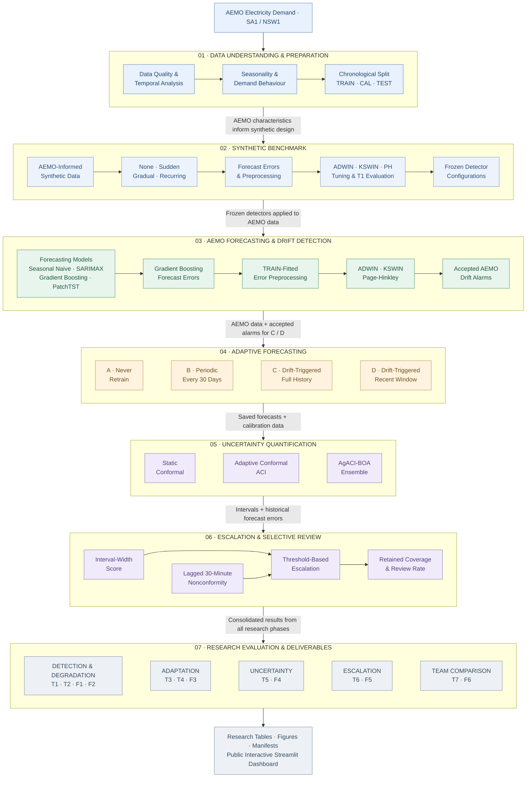

# Detecting and Adapting to Concept Drift in Time-Series Forecasting

**A research framework for detecting changes in electricity-demand forecasting, adapting predictive models, quantifying uncertainty, and evaluating selective human review.**

### Project identity and attribution

**Project:** Detecting and Adapting to Concept Drift in Time-Series Forecasting  
**Research team:** PG-S2-42 | Capstone project | Adelaide University  
**Domain:** Time-series machine learning, drift detection, adaptive forecasting, uncertainty quantification  
**Data:** Australian Energy Market Operator (AEMO) NEM regional electricity demand; synthetic benchmark
## Interactive research dashboard

### [Explore the Streamlit dashboard](https://detecting-and-adapting-to-concept-drift-in-time-series-forecas.streamlit.app/)

Explore Team 42's research through a public, nine-stage interactive dashboard built from saved experimental results. For a guide to its features, five-day historical replay, and deployment, see the [Dashboard section](#dashboard).

## Research repository

This repository contains the research implementation for **Team 42 (PG-S2-42)**. It integrates Australian Energy Market Operator (AEMO) National Electricity Market (NEM) demand data, controlled synthetic drift benchmarks, online change detection, causal model adaptation, conformal uncertainty estimation, and review-based selective prediction.

## Contents

1. [Interactive research dashboard](#interactive-research-dashboard)
2. [Research repository](#research-repository)
3. [Research question and objectives](#research-question-and-objectives)
4. [System architecture](#system-architecture)
5. [Data and chronological protocol](#data-and-chronological-protocol)
6. [Forecasting models](#forecasting-models)
7. [Concept-drift detection](#concept-drift-detection)
8. [Four-arm adaptation experiment](#four-arm-adaptation-experiment)
9. [Uncertainty quantification](#uncertainty-quantification)
10. [Escalation and human-review analysis](#escalation-and-human-review-analysis)
11. [Evaluation outputs and result navigation](#evaluation-outputs-and-result-navigation)
12. [Installation and quick start](#installation-and-quick-start)
13. [Reproducing the experiments](#reproducing-the-experiments)
14. [Repository structure](#repository-structure)
15. [Testing and reproducibility safeguards](#testing-and-reproducibility-safeguards)
16. [Dashboard](#dashboard)
17. [Interpretation, limitations and responsible use](#interpretation-limitations-and-responsible-use)
18. [Team contributions and component responsibilities](#team-contributions-and-component-responsibilities)
19. [Documentation and project references](#documentation-and-project-references)
20. [Research synthesis](#research-synthesis)

## Research question and objectives

Electricity demand changes with seasonality, weather, behavioural shifts, solar generation, and market or system events. A model trained on an earlier period can lose accuracy when the relationship between its inputs and future demand changes. Rather than assume a single permanently valid forecasting model, this project studies whether *detecting and responding to changes* can improve forecasting reliability.

The project investigates five connected questions:

- **Baseline degradation:** How does forecast accuracy change around documented events and across a long held-out stream?
- **Drift detection:** How effectively do online statistical detectors identify meaningful changes in forecast-error behaviour, and what is their false-alarm burden?
- **Adaptation:** When should a forecaster be retrained, and how much history should it use?
- **Uncertainty:** How do fixed and online-adaptive prediction intervals behave before, during, and after documented events?
- **Selective review:** What coverage and review-rate trade-offs result when uncertain forecasts are flagged for human attention?

The primary real-world study is on **SA1 (South Australia)** and **NSW1 (New South Wales)**. The shared comparison with Team 41 contrasts **forecast-error-based drift detection (Team 42)** with **demand-distribution-based detection (Team 41)**; the teams' implementations and forecast models are not necessarily identical. See [shared experimental decisions](docs/decisions.md).

## System architecture



**Diagram interpretation:** Cross-phase arrows summarise research dependencies and handoffs, rather than indicating that all computations execute sequentially. **Important boundaries:** Detector selection is calibrated upstream of the adaptation experiments. The adaptation runner consumes *frozen accepted alarm timestamps* instead of re-tuning detectors. Uncertainty experiments read saved forecasts, and evaluation-only table/figure generators do not retrain the model. Those boundaries help distinguish model fitting from retrospective analysis.

### Main software components

| Layer | Source | Responsibility |
| --- | --- | --- |
| Data loading | [`src/drift_lab/data_loader.py`](src/drift_lab/data_loader.py) | AEMO input handling and chronological partitions |
| Synthetic benchmark | [`src/drift_lab/synthetic_generator.py`](src/drift_lab/synthetic_generator.py) | Controlled synthetic time-series generation |
| Forecasters | [`src/drift_lab/forecasters.py`](src/drift_lab/forecasters.py) | Shared `fit`/`predict` models and causal forecast-error streams |
| Preprocessing | [`src/drift_lab/deseasonalise.py`](src/drift_lab/deseasonalise.py) | Seasonal adjustment and training-fitted error standardisation |
| Detectors | [`src/drift_lab/detectors.py`](src/drift_lab/detectors.py) | Configurations, detection and protocol handling |
| Adaptation | [`src/drift_lab/adaptation.py`](src/drift_lab/adaptation.py) | Chronological adaptive forecasting and retraining |
| Prediction intervals | [`src/drift_lab/uncertainty.py`](src/drift_lab/uncertainty.py), [`src/drift_lab/agaci.py`](src/drift_lab/agaci.py) | Static, adaptive and experimental conformal methods |
| Evaluation | [`src/drift_lab/evaluation.py`](src/drift_lab/evaluation.py) | Accuracy, matching, regime and coverage metrics |
| Provenance | [`src/drift_lab/run_logger.py`](src/drift_lab/run_logger.py) | Experiment logging |
| Presentation | [`dashboard/app.py`](dashboard/app.py) | Visualizations and historical-result replay |

## Data and chronological protocol

### Real-world dataset

The study uses **AEMO half-hourly regional electricity-demand observations**, especially `TOTALDEMAND` in MW, for two NEM regions. Regional source files are under `data/raw/SA1/` and `data/raw/NSW1/`; processed data are available under `data/processed/`.

| Partition | Period (fixed AEST / UTC+10) | Role |
| --- | --- | --- |
| **TRAIN** | 1 Jan 2018 – 31 Dec 2019 | Fit forecasters and training-based preprocessing |
| **CALIBRATION** | 1 Jan 2020 – 29 Feb 2020 | Detector warm-up as implemented and conformal calibration |
| **TEST** | From 1 Mar 2020, through the stored evaluation endpoint in early Jan 2024 | Chronological out-of-sample evaluation |

The stored T5 interval streams contain **67,249 half-hourly test observations per configuration**, from **2020-03-01 00:00** through **2024-01-01 00:00**, inclusive, as documented in [`docs/T5_EVALUATION.md`](docs/T5_EVALUATION.md). The exact number of samples and end boundary depend on the artifact and protocol; do not infer that every file shares the same endpoint.

**Temporal integrity:** Model evaluation is chronological. For a forecast at time `t`, only preceding observed demand and known calendar features may be used. Ground-truth demand at `t` may update online state *after* the forecast/interval has been produced. Training, calibration and testing have distinct roles to reduce leakage.

### Event catalogue and regimes

[`data/events.csv`](data/events.csv) records documented historical NEM and regional events. [`docs/event_tiering_criteria.md`](docs/event_tiering_criteria.md) defines a primary Tier-1 layer and a contextual Tier-2 layer. The catalogue is an **imperfect contextual reference**, not exhaustive, timestamp-precise ground truth for concept drift. The shared experimental decisions exclude Five-Minute Settlement from the demand-drift target catalogue, distinguishing demand-related events from market rule changes.

Evaluation has several **different temporal rules**:

- **T2 event matching:** Detection timestamps are matched to event anchors using the versioned one-to-one matching protocol; see [`docs/aemo_matching_protocol.md`](docs/aemo_matching_protocol.md). A detection must not precede the event start. The seven-day tolerance is distinct from the refractory period.
- **Full-stream T3/T5 regime evaluation:** The documented full-scope implementation uses buffered event intervals, with mutually exclusive `pre-drift`, `drift`, and `post-drift` labels covering the test stream; see [`docs/decisions.md`](docs/decisions.md) and [`docs/T5_EVALUATION.md`](docs/T5_EVALUATION.md).
- **Event-local analysis:** An alternative protocol compares the seven days before an event, its documented duration, and the seven days after. It does not use every test observation.

The respective protocols distinguish detector-event matching, global regime labelling, and event-local analysis.

### Synthetic benchmark

Controlled streams support detector calibration and evaluation of known/no-drift conditions before real-world application. Synthetic detector configurations are intended to respect a **no-drift control** and a **false-alarm budget of at most two per year**, using seeds **1–5**, before being frozen for AEMO analysis. The corresponding experiment code is under [`experiments/detection/`](experiments/detection/).

## Forecasting models

The repository provides a common forecasting interface, `fit(train)` and `predict(data, history_df=None)`, in [`src/drift_lab/forecasters.py`](src/drift_lab/forecasters.py).

| Model | Purpose | Notes |
| --- | --- | --- |
| Seasonal Naive | Transparent reference baseline | Uses a seasonal historical observation, typically the same half-hour of the previous day |
| SARIMAX | Classical statistical baseline | Fitted parameters are frozen during baseline test evaluation; specific leakage tests are included |
| Gradient Boosting | Primary model in the integrated experiments | `HistGradientBoostingRegressor`-based forecaster with calendar and lag features, including 48 and 336 half-hour lags |
| PatchTST | Transformer-based forecasting model | Evaluated in forecasting and degradation experiments; Gradient Boosting is used for the integrated drift-adaptation pipeline |

A frozen-model evaluation keeps fitted parameters fixed while allowing previously observed demand to supply causal lag context. **Adaptive retraining is a separate experiment**, not an implicit part of the frozen baseline.

Key sources: [`experiments/model_selection/select_forecaster.py`](experiments/model_selection/select_forecaster.py), [`experiments/degradation/run_baseline_degradation_evaluation.py`](experiments/degradation/run_baseline_degradation_evaluation.py), and the [`tests/degradation/`](tests/degradation/) tests.

## Concept-drift detection

The online detectors are **ADWIN**, **KSWIN**, and **Page-Hinkley**, implemented with River and configured by [`src/drift_lab/detectors.py`](src/drift_lab/detectors.py). The primary Team 42 signal is the **forecast-error stream**, rather than raw demand.

The current AEMO detection runner documents:

1. A forecasting model fitted on TRAIN data;
2. TRAIN-fitted seasonal adjustment and error Z-score standardisation;
3. Detector-specific preprocessing (partial AR(1) whitening for ADWIN/KSWIN; no whitening for Page-Hinkley in the documented runner);
4. Chronological warm-up on CALIBRATION errors without recording warm-up alarms;
5. Accepted TEST detections with **14-day refractory suppression**.

The refractory period suppresses repeat accepted alarms, while the matching grace period evaluates temporal alignment with documented events. A real-world detection unmatched to the catalogue is **not automatically a false alarm**: the catalogue is incomplete and does not establish causal ground truth.

Useful entry points:

- [`experiments/detection/run_synthetic_drift_detection.py`](experiments/detection/run_synthetic_drift_detection.py) — synthetic detection;
- [`experiments/detection/tune_detectors_deseasonalized_zscore.py`](experiments/detection/tune_detectors_deseasonalized_zscore.py) — tuning;
- [`experiments/detection/run_aemo_drift_detection.py`](experiments/detection/run_aemo_drift_detection.py) — accepted AEMO detections;
- [`experiments/detection/run_aemo_t2_evaluation.py`](experiments/detection/run_aemo_t2_evaluation.py) — event matching from saved detections;
- [`experiments/detection/plot_f2_detection_panel.py`](experiments/detection/plot_f2_detection_panel.py) — detection visualization.

The accepted detection file used downstream is [`results/tables/detection/aemo_detection_changepoints.csv`](results/tables/detection/aemo_detection_changepoints.csv). The matching procedure, event applicability, Tier-1/Tier-2 priority, and chance baseline are documented in [`docs/aemo_matching_protocol.md`](docs/aemo_matching_protocol.md).

## Four-arm adaptation experiment

The experiment asks whether and how models should retrain when demand behaviour changes.

| Arm | Policy | Retraining data |
| --- | --- | --- |
| **A** | Never retrain | The original fitted model remains in use |
| **B** | Retrain every **30 days** | Periodic policy, independent of detector alarms |
| **C** | Retrain at an accepted drift alarm | Full causally available history |
| **D** | Retrain at an accepted drift alarm | Only the most recent **30, 60, 120 or 180 days** |

**For Arm D, 30/60/120/180 days is the *training-history length*, not the retraining frequency.** Arm B remains on a 30-day calendar schedule. Arms C and D use detector-specific accepted alarms from the upstream detection stage and, within a given detector comparison, share the same trigger timestamps.

There are **17 configurations per region**: A, B, three detector-specific C configurations, and twelve D configurations (three detectors × four history windows). Experiments use forecasting seeds 1–5 for the five-seed output. The runner checks provenance, causal ordering, training boundaries and frozen alarm inputs; it does not recalibrate the detector.

Relevant files: [`docs/PGS242-128_README.md`](docs/PGS242-128_README.md), [`docs/PGS242-128_REVISION.md`](docs/PGS242-128_REVISION.md), [`experiments/adaptation/run_four_arm_adaptation.py`](experiments/adaptation/run_four_arm_adaptation.py).

### Final five-seed adaptation evaluation

The current T3 and T4 evaluations report results across **seeds 1–5** for the four adaptation policies. T3 separates forecast accuracy by drift regime, using both full-stream and event-local scopes; T4 assesses forecast error alongside retraining counts and computational cost. The results are available in the [T3 full-stream summary](results/tables/adaptation/t3/t3_full.md), [T3 event-local summary](results/tables/adaptation/t3/t3_local.md), and [T4 cost table](results/tables/adaptation/t4/t4_adaptation_cost.csv). Historical single-run results and implementation revisions remain documented in [`docs/PGS242-128_README.md`](docs/PGS242-128_README.md).

## Uncertainty quantification

Point forecasts do not themselves describe uncertainty. This project evaluates **nominal 90% prediction intervals** around the forecasts, using calibration data and, for online methods, only causally available observations.

- **Static conformal:** A fixed symmetric radius calculated from calibration residuals. The initial interface returns `(lower_bound, upper_bound, escalate_flag)`. Its original `escalate_flag` remains inactive; review policies are evaluated in a separate stage.
- **Adaptive conformal inference (ACI):** Adjusts the online error-rate state over the test stream. The observed `y_t` is used only *after* interval `t` has been emitted.
- **AgACI-BOA:** An adaptive conformal ensemble that aggregates multiple learning-rate experts using BOA. Its implemented AEMO evaluation employs fixed calibration and differs from the original rolling-retrained AgACI protocol.

Sources: [`src/drift_lab/uncertainty.py`](src/drift_lab/uncertainty.py), [`src/drift_lab/agaci.py`](src/drift_lab/agaci.py), [`experiments/uncertainty/run_aemo_uncertainty.py`](experiments/uncertainty/run_aemo_uncertainty.py), [`run_aemo_adaptive_conformal.py`](experiments/uncertainty/run_aemo_adaptive_conformal.py), and [`run_aemo_agaci.py`](experiments/uncertainty/run_aemo_agaci.py).

### T5 — Prediction interval reliability across drift regimes

The extended T5 evaluation compares **three uncertainty-quantification methods**—static conformal, adaptive conformal inference (ACI), and AgACI-BOA—across **SA1 and NSW1, 17 forecasting configurations, and five seeds (1–5)**. Its main three-method results are held in [`results/tables/uncertainty/t5_agaci_full_post7/`](results/tables/uncertainty/t5_agaci_full_post7/), with the corresponding [`T5 manifest`](results/tables/uncertainty/t5_agaci_full_post7/t5_manifest.json). The earlier two-method AEMO evaluation is retained separately in [`results/tables/uncertainty/t5_aemo/`](results/tables/uncertainty/t5_aemo/).

| Metric | Definition |
| --- | --- |
| Empirical coverage | Proportion of observations contained in the prediction interval |
| Mean interval width | Average upper minus lower prediction bound (MW) |
| Normalised interval width | Mean width divided by the corresponding regional TRAIN mean actual demand |
| Worst 24-hour coverage | Minimum coverage across eligible complete 48-observation windows |

The three-method protocol uses **full-stream regime evaluation**, seven-day event buffers, complete *within-regime* rolling 24-hour windows, and a minimum reporting support of 10 eligible windows. Values are aggregated as **mean ± sample standard deviation** across five seeds. Normalisation is fixed using training-period demand: approximately **1,300.87 MW (SA1)** and **7,982.25 MW (NSW1)**. The rolling windows overlap and are not statistically independent.

As one illustration from the stored **SA1 / Arm A / drift** results:

| UQ method | Coverage | Mean interval width | Worst 24h coverage |
| --- | ---: | ---: | ---: |
| Static conformal | 91.94% | 860.23 MW | 26.67% |
| ACI | 89.79% | 741.26 MW | 45.83% |
| AgACI-BOA | 91.07% | 584.37 MW | 66.67% |

These are **one configuration and regime**, not global averages. The example demonstrates how overall coverage, interval sharpness, and worst-window reliability can produce different method comparisons. Complete region/configuration/regime tables and seed variability are in the [three-method T5 results](results/tables/uncertainty/t5_agaci_full_post7/).

### F4 — Temporal coverage dynamics

F4 traces moving-window prediction-interval coverage over the held-out test stream. It complements T5's regime aggregates by revealing temporal variability and periods of deterioration. See [`docs/F4_COVERAGE_TRAJECTORY.md`](docs/F4_COVERAGE_TRAJECTORY.md) and [`generate_f4_coverage_trajectory.py`](experiments/uncertainty/generate_f4_coverage_trajectory.py).

## Escalation and human-review analysis

The escalation study investigates **selective prediction**: an uncertainty-related signal flags a subset of forecasts for review, and empirical interval coverage is evaluated on the remaining, unflagged subset. This is an offline review-allocation analysis; it does not model corrections made by a human reviewer.

Two complementary T6 analyses are available, each comparing **static conformal, ACI, and AgACI-BOA** across the adaptation configurations, regions, seeds, and pre-drift/drift/post-drift regimes.

| T6 approach | Causal review signal | Stored operating points | Source sweep |
| --- | --- | --- | --- |
| **Interval width** | Current prediction interval width, `upper_t − lower_t`, available before the target is observed | [`t6_interval_width/T6_operating_points.md`](results/tables/uncertainty/t6_interval_width/T6_operating_points.md) | [`escalation_agaci_full_post7/`](results/series/escalation_agaci_full_post7/) |
| **Lagged nonconformity (30 min)** | Absolute error from the preceding half-hour, `abs(y_(t−1) − ŷ_(t−1))`, available after the prior outcome is observed | [`t6_nonconformity_30min/T6_operating_points.md`](results/tables/uncertainty/t6_nonconformity_30min/T6_operating_points.md) | [`escalation_lag1_nonconformity_full_post7/`](results/series/escalation_lag1_nonconformity_full_post7/) |

Both approaches use the strict decision rule **flag if the score exceeds the threshold**. Review rate is the proportion flagged; *retained coverage* is the empirical coverage of unflagged forecasts and is undefined when no observations remain. Evaluation uses observed discrete threshold points without interpolation.

T6 reports the **minimum review rate needed to reach 90% and 95% retained coverage**, and the **highest achievable retained coverage under review budgets of 5%, 10%, and 20%**. A target may be unreachable at the evaluated thresholds. Budget constraints are upper bounds, rather than requirements to review exactly that proportion. A separate `all` regime provides whole-stream context.

The two score definitions measure different properties: interval width expresses the model's current predictive uncertainty, whereas the lagged absolute-error score reflects recently observed forecasting performance. Their outputs therefore represent distinct selection policies, not interchangeable estimates. Both use identical five-seed aggregation conventions and retain per-run provenance through their respective [`interval-width manifest`](results/tables/uncertainty/t6_interval_width/t6_manifest.json) and [`lagged-error manifest`](results/tables/uncertainty/t6_nonconformity_30min/t6_manifest.json).

F5 visualises the corresponding **retained-coverage versus review-rate** trade-offs by regime. See [`generate_f5_escalation_curve.py`](experiments/uncertainty/generate_f5_escalation_curve.py), [`generate_t6_escalation_table.py`](experiments/uncertainty/generate_t6_escalation_table.py), and [`docs/ESCALATION_SWEEP.md`](docs/ESCALATION_SWEEP.md).

## Evaluation outputs and result navigation

The following index links each required deliverable to its **implemented analysis** and **stored results**. Figure links lead directly to the current output images or their figure collections. The T7 and F6 comparative views are generated within the dashboard from saved source data.

| Output | Research question / analysis | Implementation | Latest results and figures |
| --- | --- | --- | --- |
| **F1 · Forecast degradation** | How does forecast error change across time and documented demand events? | [`run_baseline_degradation_evaluation.py`](experiments/degradation/run_baseline_degradation_evaluation.py) | [F1 SA1 figures](results/figures/degradation/F1_SA1_forecasting_degradation.png) · [F1 NSW1 figures](results/figures/degradation/F1_NSW1_forecasting_degradation.png) · [All degradation figures](results/figures/degradation/) |
| **T1 · Synthetic drift detection** | What are detection delay, missed-change and false-alarm outcomes under known synthetic regimes? | [`generate_t1_detection_table.py`](experiments/detection/generate_t1_detection_table.py) · [`run_synthetic_drift_detection.py`](experiments/detection/run_synthetic_drift_detection.py) | [T1 detection table](results/tables/detection/T1_detection_on_synthetic.csv) · [Synthetic detection figures](results/figures/detection/) |
| **T2 · AEMO event matching** | How do accepted drift alarms align with the documented AEMO event catalogue? | [`run_aemo_t2_evaluation.py`](experiments/detection/run_aemo_t2_evaluation.py) | [T2 result table](results/tables/detection/T2_aemo_detection.md) · [Event matches](results/tables/detection/T2_detection_matches.csv) · [Manifest](results/tables/detection/T2_manifest.json) |
| **F2 · Detection panels** | When and where do detected changes occur in the AEMO demand stream? | [`plot_f2_detection_panel.py`](experiments/detection/plot_f2_detection_panel.py) · [`plot_f2_detection_panel_individual.py`](experiments/detection/plot_f2_detection_panel_individual.py) | [SA1 combined panel](results/figures/detection/F2_detection_panel_SA1.png) · [NSW1 combined panel](results/figures/detection/F2_detection_panel_NSW1.png) · [Individual detector panels](results/figures/detection/F2_individual/) |
| **T3 · Forecast accuracy by regime** | How does MAE differ across adaptation configurations and pre-drift, drift and post-drift periods? | [`generate_t3_forecast_accuracy.py`](experiments/adaptation/generate_t3_forecast_accuracy.py) | [Full-stream T3 summary](results/tables/adaptation/t3/t3_full.md) · [Event-local T3 summary](results/tables/adaptation/t3/t3_local.md) · [Five-seed observations](results/tables/adaptation/t3/t3_seed_metrics_full.csv) · [Manifest](results/tables/adaptation/t3/t3_manifest.json) |
| **T4 · Adaptation cost** | What changes in forecast accuracy accompany retraining counts, volume and runtime? | [`generate_t4_adaptation_cost.py`](experiments/adaptation/generate_t4_adaptation_cost.py) | [T4 cost table](results/tables/adaptation/t4/t4_adaptation_cost.csv) · [All configurations](results/tables/adaptation/t4/t4_all_configurations.csv) · [Five-seed metrics](results/tables/adaptation/t4/t4_seed_level_metrics.csv) |
| **F3 · Four-arm comparison** | How do the four adaptation strategies differ in their forecast-error trajectories? | [`generate_f3_four_arm_comparison.py`](experiments/adaptation/generate_f3_four_arm_comparison.py) | [F3 figures — SA1 and NSW1, three detectors](results/figures/adaptation/F3_four_arms/) |
| **T5 · Prediction-interval reliability** | How do static conformal, ACI and AgACI-BOA compare on coverage, interval width and worst-window reliability? | [`generate_t5_uncertainty_table.py`](experiments/uncertainty/generate_t5_uncertainty_table.py) · [`run_aemo_agaci.py`](experiments/uncertainty/run_aemo_agaci.py) | [Final three-method T5 tables](results/tables/uncertainty/t5_agaci_full_post7/) · [T5 manifest](results/tables/uncertainty/t5_agaci_full_post7/t5_manifest.json) |
| **F4 · Temporal coverage trajectories** | How do rolling prediction-interval coverage and width vary over time? | [`generate_f4_coverage_trajectory.py`](experiments/uncertainty/generate_f4_coverage_trajectory.py) | [F4 figures and underlying data](results/figures/uncertainty/f4/) · [SA1 example](results/figures/uncertainty/f4/F4_SA1_page_hinkley_four_arms.png) · [NSW1 example](results/figures/uncertainty/f4/F4_NSW1_page_hinkley_four_arms.png) |
| **T6 · Review operating points** | What review rates are required to meet coverage targets, and what coverage is achieved under fixed review budgets? | [`run_escalation_sweep.py`](experiments/uncertainty/run_escalation_sweep.py) · [`run_escalation_lag1_nonconformity.py`](experiments/uncertainty/run_escalation_lag1_nonconformity.py) · [`generate_t6_escalation_table.py`](experiments/uncertainty/generate_t6_escalation_table.py) | [Interval-width T6 tables](results/tables/uncertainty/t6_interval_width/) · [Width operating points](results/tables/uncertainty/t6_interval_width/T6_operating_points.md) · [Lagged-error T6 tables](results/tables/uncertainty/t6_nonconformity_30min/) · [Lagged-error operating points](results/tables/uncertainty/t6_nonconformity_30min/T6_operating_points.md) |
| **F5 · Review–coverage trade-offs** | How does retained empirical coverage change with review rate under both escalation signals? | [`generate_f5_escalation_curve.py`](experiments/uncertainty/generate_f5_escalation_curve.py) | [F5 interval-width figures](results/figures/uncertainty/f5_width/) · [F5 lagged-error figures](results/figures/uncertainty/f5_nonconformity/) · [Width curve data](results/figures/uncertainty/f5_width/F5_curve_points_five_seed.csv) · [Lagged-error curve data](results/figures/uncertainty/f5_nonconformity/F5_curve_points_five_seed.csv) |
| **T7 · Cross-team trigger comparison** | How do demand-distribution-based and forecast-error-based trigger approaches compare, accounting for different forecasters and UQ implementations? | [`dashboard/app.py` — `render_t7()`](dashboard/app.py) | [Team 42 T4 seed metrics](results/tables/adaptation/t4/t4_seed_level_metrics.csv) · [T5 three-method results](results/tables/uncertainty/t5_agaci_full_post7/) · [T6 operating points](results/tables/uncertainty/t6_interval_width/T6_operating_points.md) · [Interactive T7 comparison](#dashboard) |
| **F6 · Trigger disagreement timeline** | Where do accepted Page-Hinkley alarm times agree or differ between Team 41 and Team 42? | [`dashboard/app.py` — `render_f6()`](dashboard/app.py) | [Team 41 accepted detections](results/tables/cross_team/team41_accepted_detections.csv) · [Team 42 accepted detections](results/tables/detection/aemo_detection_changepoints.csv) · [Interactive SA1/NSW1 F6 timeline](#dashboard) |

**Comparative-output provenance:** T7 is assembled by the dashboard from Team 42's stored T4–T6 results and the Team 41 summary values recorded in the application; it is not a separately committed final T7 table. F6 is rendered interactively from accepted detection timestamps and can be exported from the dashboard. This distinction preserves traceability without presenting dynamically generated views as static repository artifacts.

## Installation and quick start

### Requirements

- **Python 3.10 or newer** (declared in [`pyproject.toml`](pyproject.toml));
- `pip`, an environment capable of installing the project dependencies, and sufficient disk space for the supplied AEMO data and stored forecasts;
- **PyTorch** for running PatchTST experiments.

From the **repository root**:

```bash
git clone https://github.com/ziqi2026/Detecting-and-Adapting-to-Concept-Drift-in-Time-Series-Forecasting.git
cd Detecting-and-Adapting-to-Concept-Drift-in-Time-Series-Forecasting

python -m venv .venv
source .venv/bin/activate             # macOS / Linux
# Windows PowerShell: .venv\Scripts\Activate.ps1

python -m pip install --upgrade pip
python -m pip install -e '.[dev]'
```

For the Streamlit dashboard, install the dashboard-specific dependencies:

```bash
python -m pip install -r dashboard/requirements.txt
streamlit run dashboard/app.py
```

The Streamlit command launches the local app and prints its local address. The dashboard expects corresponding files under `results/`; missing result assets may cause warnings or empty sections.

Optional Transformer dependencies can be installed with `python -m pip install -e '.[patchtst]'`, subject to a compatible PyTorch build for the user's environment. **Dependency versions are not fully pinned**, so a clean environment is recommended for reproducibility.

### Verify installation

```bash
python -m pytest -q
```

Some advanced integration tests depend on stored experiment artifacts, pinned revision exports, or Git LFS materialization; consult the specific test documentation if a full suite cannot run against a minimal checkout.

## Reproducing the experiments

The experimental dependency structure is: AEMO data exploration and preparation → synthetic detector calibration → AEMO forecasting and drift detection → adaptation → uncertainty quantification → escalation evaluation → figures, tables, and dashboard.

The following are documented starting points, **not** a guarantee that every experiment runs without additional pinned artifacts, protocol JSON, or specific CLI flags. Inspect `--help` and the associated docs before launching long runs.

### 1. Adaptation (documented five-seed command)

```bash
python experiments/adaptation/run_four_arm_adaptation.py \
  --detections results/tables/detection/aemo_detection_changepoints.csv \
  --decisions docs/decisions.md \
  --detectors adwin page_hinkley kswin \
  --run-id four_arm_adaptation_NEW_RUN_ID \
  --seeds 1 2 3 4 5
```

Each unique run ID generates its own directory under `results/tables/adaptation/revised/` and avoids overwriting an existing experiment. Stored seed-specific forecasts and a consolidated summary/manifest support downstream analysis.

### 2. Evaluate T2 from the frozen detection output

```bash
python experiments/detection/run_aemo_t2_evaluation.py --help
```

This evaluation **consumes saved detections**; it does not re-run a forecaster or detector. Check [`docs/aemo_matching_protocol.md`](docs/aemo_matching_protocol.md) and ensure its expected protocol files and manifests are present.

### 3. Evaluate uncertainty and escalation

```bash
python experiments/uncertainty/run_aemo_adaptive_conformal.py --help
python experiments/uncertainty/run_aemo_agaci.py --help
python experiments/uncertainty/generate_t5_uncertainty_table.py --help
python experiments/uncertainty/run_escalation_sweep.py --help
python experiments/uncertainty/generate_t6_escalation_table.py --help
```

These stages consume upstream timestamp-level outputs. The extended three-method T5 evaluation is documented by its [manifest](results/tables/uncertainty/t5_agaci_full_post7/t5_manifest.json); separate T6 outputs report interval-width and lagged-nonconformity policies.

### 4. Generate a review-rate figure from stored sweep data

```bash
python experiments/uncertainty/generate_f5_escalation_curve.py \
  --sweep results/series/escalation_agaci_full_post7/escalation_sweep.csv \
  --output-dir results/figures/f5_interval_width \
  --score-label 'Interval width'
```

The figure generator reads stored sweep points and does not perform model fitting or threshold interpolation.

## Repository structure

```text
.
├── README.md                      # Project overview and navigation
├── pyproject.toml                 # Installable drift-lab package
├── data/
│   ├── raw/                      # Monthly SA1 / NSW1 AEMO inputs
│   ├── processed/                # Prepared regional datasets
│   └── events.csv                # Documented event catalogue
├── src/drift_lab/
│   ├── data_loader.py
│   ├── synthetic_generator.py
│   ├── forecasters.py
│   ├── deseasonalise.py
│   ├── detectors.py
│   ├── detector_diagnostics.py
│   ├── adaptation.py
│   ├── uncertainty.py
│   ├── agaci.py
│   ├── evaluation.py
│   ├── run_logger.py
│   └── interfaces.py
├── experiments/
│   ├── model_selection/
│   ├── degradation/
│   ├── detection/
│   ├── adaptation/
│   └── uncertainty/
├── notebooks/                    # Exploratory and evaluation notebooks
├── dashboard/
│   ├── app.py                    # Streamlit presentation
│   └── requirements.txt
├── docs/                         # Methods, protocols, validation notes
├── results/                      # Versioned tables, charts, streams and logs
├── tests/                        # Unit and integration tests
└── Archive/                      # Older development artifacts
```

## Testing and reproducibility safeguards

The project includes tests for forecasting chronology, SARIMAX leakage, detector evaluation, adaptation boundaries, uncertainty calculations, causal lagged signals and generated tables. Relevant files are under [`tests/`](tests/).

```bash
# All locally runnable tests
python -m pytest -q

# Adaptation-focused checks
PYTHONPATH=src python -m pytest -q tests/adaptation

# Detection evaluation checks
PYTHONPATH=src python -m pytest -q tests/detection

# Uncertainty checks
PYTHONPATH=src python -m pytest -q tests/uncertainty
```

On Windows PowerShell, set `$env:PYTHONPATH = 'src'` before a command that needs it, or install the package in editable mode as shown above.

Reproducibility features include **fixed chronological splits**, **training-only fitting** of preprocessing, **causal online updates**, **multiple seeds**, **configuration identifiers and file hashes**, **run manifests**, **test coverage**, and **per-run or shared CSV logs**. Not all results are guaranteed to be consolidated into a single `results/runs.csv`: some runs deliberately maintain independent logs. See individual result READMEs.

**Git LFS / large files:** Certain interval streams or experiment assets may require the actual Git LFS objects rather than text pointers. If a run complains about missing compressed artifacts, verify that the correct version and complete objects are available; do not replace missing inputs with generated approximations and then claim exact reproduction.

## Dashboard

**Public research demonstration:** [Concept Drift Lab — Team 42](https://detecting-and-adapting-to-concept-drift-in-time-series-forecas.streamlit.app/)

The dashboard presents stored forecasting, drift-detection, adaptation, uncertainty and selective-review experiments in one interactive interface. These are **historical research results**, not a live AEMO feed, operational forecasting service, or evidence of actual human corrections.

### Explore the nine dashboard stages

Use the **Explore the research** sidebar to navigate the dashboard. The stage names below match the navigation labels defined in [`dashboard/app.py`](dashboard/app.py).

| Dashboard stage | What you can explore |
| --- | --- |
| **01 · Project Overview** | Research questions, AEMO regions, experimental chronology, forecasting methods, drift detectors, four adaptation arms, and the integrated methodology. |
| **02 · Ethical Considerations** | Ethical, societal and security implications of drift alarms, retraining decisions, uncertainty calibration, data integrity and human oversight. |
| **03 · Forecast Degradation** | F1 rolling forecast error and baseline degradation figures for SA1 and NSW1, including PatchTST degradation results. |
| **04 · Drift Detection** | Switch between **T1 · Synthetic benchmark** and **T2 / F2 · AEMO event matching** to examine detector results, alarms and event-alignment figures. |
| **05 · Forecast Adaptation** | Switch between **Interactive forecasts**, **F3 · Four-arm comparison**, **T3 · Forecast accuracy**, **T4 · Adaptation cost**, and **Model selection** to compare forecasting and retraining strategies. |
| **06 · Uncertainty & Reliability** | T5 prediction-interval coverage and width across static conformal, ACI and AgACI-BOA, alongside F4 temporal coverage trajectories. |
| **07 · Human Escalation** | Select **Five-day interactive explorer**, **F5 · Review–coverage curves**, or **T6 · Operating-point table** to examine the two review-prioritisation scores and their coverage–workload trade-offs. |
| **08 · Trigger Comparison** | T7 comparison of Team 41 demand-distribution triggers with Team 42 forecast-error triggers, plus the **F6 · Trigger disagreement timeline** for SA1 or NSW1. |
| **09 · Integrated System & Research Synthesis** | The integrated historical replay, combining demand, saved forecasts, accepted alarms, retraining events, prediction intervals and review decisions, followed by research synthesis and supporting outputs. |

### How to navigate the dashboard

1. Open the [public dashboard](https://detecting-and-adapting-to-concept-drift-in-time-series-forecas.streamlit.app/) and select a numbered stage from **Explore the research** in the sidebar.
2. Start with **01 · Project Overview**, then use **03 · Forecast Degradation** and **04 · Drift Detection** to investigate forecasting errors and detector performance. Stage 02 provides the ethical and security context.
3. In **05 · Forecast Adaptation**, select an analysis using **Explore adaptation**; inspect forecast accuracy, retraining cost and four-arm comparisons. Continue to **06 · Uncertainty & Reliability** for prediction-interval evidence.
4. In **07 · Human Escalation**, choose an **Escalation view** to inspect five-day review decisions, F5 curves or T6 operating points. Use **08 · Trigger Comparison** for the Team 41 / Team 42 comparison.
5. Finish at **09 · Integrated System & Research Synthesis** to explore the combined historical replay and supporting research outputs. Select regions, detectors, configurations, uncertainty methods and seeds in the views that offer those controls.

### Integrated historical replay — five-day windows

In **09 · Integrated System & Research Synthesis**, select a historical replay date to display a **five-day window** of held-out AEMO observations and saved results. Explore observed electricity demand and point forecasts together with prediction intervals, accepted drift alarms, retraining events and review-prioritisation signals. Change the date to move through the historical stream and compare how the components behave before, during and after periods of changing demand.

For a focused view of escalation decisions, **07 · Human Escalation → Five-day interactive explorer** also provides five-day windows. There you can switch between the **Previous 30-minute absolute error** and **Current interval width** review signals and examine the corresponding threshold-based review decisions and interval coverage.

The five-day windows are visualization controls over recorded experiments; they do not rerun the forecasting or detection pipeline.

### Dashboard implementation and deployment

The application is deployed through a **lightweight Streamlit deployment repository**, separately from this full research repository. An earlier deployment from the research workspace encountered resource constraints because the interactive demonstration requires large result datasets. Separating the application from the full experimental workspace reduced the data packaged with the deployed app. Large uncertainty artifacts are distributed through **GitHub Releases** rather than committed directly to the lightweight deployment repository.

| Component | Responsibility |
| --- | --- |
| **Public Streamlit application** | Navigable presentation of the research and integrated historical replay |
| **Lightweight deployment repository** | Hosts the independently deployed application |
| **GitHub Releases** | Distributes large uncertainty-result artifacts required by interactive views |
| **Research repository (this repository)** | Implements forecasting, detection, adaptation, uncertainty, evaluation and reproducibility resources |
| **Saved experimental artifacts** | Supply the underlying observations, forecasts, intervals, alarms, retraining records, tables and figures |

The research repository also contains the local application entry point at [`dashboard/app.py`](dashboard/app.py). When the relevant experimental artifacts are available locally, run:

```bash
streamlit run dashboard/app.py
```

The **public deployment and the repository's local app are related but distinct**. The hosted application is designed for convenient exploration of results; the research code and saved artifacts document how those results were produced. Dashboard interactions do not imply that models are retrained or detectors recalibrated on demand.

## Interpretation, limitations and responsible use

### Interpretation of drift evidence

The synthetic benchmark provides controlled conditions in which changepoints and no-drift cases are specified. In contrast, the AEMO event catalogue offers **contextual evidence**, not exhaustive or causally established ground truth for concept drift. Consequently, a match between an accepted alarm and a documented event does not establish causation, and an unmatched alarm should not automatically be classified as a false positive. Detector sensitivity must also be interpreted alongside alarm frequency, adaptation performance, and retraining cost.

### Experimental validity and uncertainty

The evaluation distinguishes chronological training, calibration, and testing. Forecasting features and preprocessing are constructed to respect the information available at each prediction time; online state updates use observed outcomes only after the corresponding forecasts or intervals have been issued. The seven-day event-matching tolerance, 14-day alarm refractory period, buffered regime assignments, and event-local windows serve separate methodological purposes and should not be interpreted interchangeably.

Reported **90% prediction intervals** have a nominal coverage target, not a guarantee of coverage within every regime, event or 24-hour period. Static conformal, ACI and AgACI-BOA are evaluated under their documented protocols; in particular, the implemented AgACI-BOA analysis uses fixed calibration and is not equivalent to a rolling-retrained formulation. Comparisons should therefore consider empirical coverage, interval width, worst-window reliability and protocol differences together.

### Scope of escalation and reproducibility

Escalation experiments evaluate threshold-based **review prioritisation** retrospectively. Review rate and retained coverage describe the subset of predictions flagged or retained under each policy; the study does not measure the effectiveness of actual human interventions or claim that flagged forecasts were corrected. The cross-team comparison likewise requires attention to differences in monitoring signals, forecasting implementations and uncertainty procedures.

Reproducibility is supported by documented chronological splits, experiment configurations, seeds, manifests, and recorded result artifacts. The public dashboard visualises historical experimental outputs and should not be interpreted as a live demand feed or a validated operational forecasting service. These boundaries define the evidential scope of the reported findings and identify areas requiring further operational validation.

## Team contributions and component responsibilities

The following table documents the technical contributions of the six members of Team 42, with links to the corresponding source files, experiments and evaluation outputs. Responsibilities are distinguished by initial implementation, subsequent development, experimental execution and evaluation where applicable. Although individual members led specific components, the research also involved collaborative methodological decisions, testing, validation and system integration.

| Research stage | Linked source file(s) | Responsible member(s) | Technical contribution |
| --- | --- | --- | --- |
| Data preparation | [`data_loader.py`](src/drift_lab/data_loader.py) | Sahar Hassan Alzahrni | AEMO data ingestion, quality checks, timestamp alignment and chronological data preparation, supported by shared data validation. |
| Data preparation | [`synthetic_generator.py`](src/drift_lab/synthetic_generator.py) | Sahar Hassan Alzahrni; Sukarna Paul | Construction of controlled synthetic benchmarks and supporting experimental data preparation. |
| Forecasting | [`forecasters.py`](src/drift_lab/forecasters.py) | Qiran (Katniss) Zhang — Seasonal Naive; Ziqi Fang — SARIMAX; Sukarna Paul — Gradient Boosting and model integration; Sahar Hassan Alzahrni — PatchTST and model integration | Development and integration of forecasting models through a common interface, with individual model responsibilities identified within the shared module. |
| Forecasting | [`select_forecaster.py`](experiments/model_selection/select_forecaster.py) | Sahar Hassan Alzahrni | Model-selection experiments and comparative assessment of forecasting baselines. |
| Forecast degradation | [`run_baseline_degradation_evaluation.py`](experiments/degradation/run_baseline_degradation_evaluation.py) · [`generate_f1_degradation_figure.py`](experiments/degradation/generate_f1_degradation_figure.py) | Sahar Hassan Alzahrni | F1 forecasting degradation experiments, figure generation and contextual interpretation. |
| Forecast degradation | [`patchtst_synthetic_degradation.py`](experiments/degradation/patchtst_synthetic_degradation.py) | Sahar Hassan Alzahrni | PatchTST forecasting and degradation investigation. |
| Drift detection | [`deseasonalise.py`](src/drift_lab/deseasonalise.py) · [`detectors.py`](src/drift_lab/detectors.py) | Sahar Hassan Alzahrni; Sebastian | Training-fitted signal preprocessing, detector interfaces, and shared detector development and validation. |
| Drift detection diagnostics (F2) | [`detector_diagnostics.py`](src/drift_lab/detector_diagnostics.py) | Qiran (Katniss) Zhang; Sahar Hassan Alzahrni | Katniss developed the detector diagnostic module to extract ADWIN, KSWIN and Page-Hinkley statistics for F2 visualisation. Sahar subsequently refined the diagnostic replay to align with the final detection pipeline, including calibration warm-up, frozen configurations and ADWIN window-width reporting. |
| Forecast-error and detector behaviour analysis | [`diagnosis/`](experiments/detection/diagnosis/) | Sahar Hassan Alzahrni | Investigated forecast-error temporal structure, autocorrelation, residual dependence, preprocessing effects and detector behaviour to support diagnostic interpretation and methodological refinement. |
| Synthetic drift detection (T1) | [`tune_detectors_deseasonalized_zscore.py`](experiments/detection/tune_detectors_deseasonalized_zscore.py) · [`run_synthetic_drift_detection.py`](experiments/detection/run_synthetic_drift_detection.py) · [`generate_t1_detection_table.py`](experiments/detection/generate_t1_detection_table.py) | Pijian Sun; Sahar Hassan Alzahrni; detection subgroup (shared) | T1 synthetic detector experiments, configuration tuning, no-drift controls, false-alarm assessment and evaluation supporting frozen detector configurations. Pijian Sun was responsible for T1 evaluation. |
| Synthetic detection visualisation | [`generate_synthetic_detection_figures.py`](experiments/detection/generate_synthetic_detection_figures.py) | Sahar Hassan Alzahrni | Generated visualisations of synthetic detector behaviour under controlled drift conditions. |
| AEMO drift detection | [`run_aemo_drift_detection.py`](experiments/detection/run_aemo_drift_detection.py) | Pijian Sun; Sahar Hassan Alzahrni | Pijian developed the original AEMO drift-detection pipeline. Sahar subsequently refined its forecast-error preprocessing through deseasonalisation and standardisation. |
| Drift detection research (PGS242-135) | [`PGS242-135_Detector_Research_Brief.pdf`](docs/PGS242-135_Detector_Research_Brief.pdf) | Sukarna Paul | Conducted a literature-based comparative study of ADWIN, Page-Hinkley and KSWIN, examining their detection mechanisms, hyperparameters, sensitivity–delay trade-offs, strengths and limitations. Interpreted the T1 synthetic-benchmark findings and assessed detector suitability for subsequent AEMO evaluation. |
| Drift detection evaluation (T2) | [`run_aemo_t2_evaluation.py`](experiments/detection/run_aemo_t2_evaluation.py) | Ziqi Fang | Implemented T2 evaluation of accepted drift alarms against documented AEMO events. |
| Drift detection visualisation (F2) | [`plot_f2_detection_panel.py`](experiments/detection/plot_f2_detection_panel.py) | Qiran (Katniss) Zhang | Developed combined F2 detection panels showing alarms alongside electricity-demand patterns and documented events. |
| Drift detection visualisation (F2 — individual panels) | [`plot_f2_detection_panel_individual.py`](experiments/detection/plot_f2_detection_panel_individual.py) | Sahar Hassan Alzahrni | Developed individual ADWIN, KSWIN and Page-Hinkley detection panels for separate inspection of alarm behaviour and event alignment. |
| Adaptation | [`adaptation.py`](src/drift_lab/adaptation.py) | Sebastian; Sahar Hassan Alzahrni | Sebastian developed the initial adaptation component. Sahar refactored retraining-schedule and training-history selection into reusable functions and strengthened causal data-handling safeguards. |
| Adaptation testing | [`test_adaptation.py`](tests/adaptation/test_adaptation.py) | Sahar Hassan Alzahrni | Developed unit tests for retraining schedules, detector-specific triggers, training-window selection and prevention of future-data leakage. |
| Four-arm adaptation implementation | [`run_four_arm_adaptation.py`](experiments/adaptation/run_four_arm_adaptation.py) | Ziqi Fang | Developed the four-arm experimental runner, integrating forecasting policies, accepted drift triggers, training-history configurations and generation of forecasting and retraining artifacts. |
| Four-arm adaptation execution | [`run_four_arm_adaptation.py`](experiments/adaptation/run_four_arm_adaptation.py) · [`five-seed results`](results/tables/adaptation/revised/pgs242_128_five_seed_final/) | Pijian Sun | Executed the four-arm adaptation experiments across five seeds and supported generation of the multi-seed experimental outputs used in downstream evaluation. |
| Adaptation evaluation (T3) | [`generate_t3_forecast_accuracy.py`](experiments/adaptation/generate_t3_forecast_accuracy.py) | Sebastian | T3 forecast-accuracy evaluation across drift regimes and adaptation configurations. |
| Adaptation evaluation (T4) | [`generate_t4_adaptation_cost.py`](experiments/adaptation/generate_t4_adaptation_cost.py) | Sukarna Paul | T4 evaluation of retraining frequency, computational cost and forecast-accuracy trade-offs. |
| Adaptation cost reporting | [`generate_t4_cost_summary.py`](experiments/adaptation/generate_t4_cost_summary.py) | Adaptation evaluation (shared) | Supporting generation and consolidation of adaptation-cost summaries. |
| Adaptation visualisation (F3) | [`generate_f3_four_arm_comparison.py`](experiments/adaptation/generate_f3_four_arm_comparison.py) | Qiran (Katniss) Zhang | Comparative F3 visualisations of the four adaptation strategies. |
| Uncertainty quantification | [`uncertainty.py`](src/drift_lab/uncertainty.py) · [`run_aemo_adaptive_conformal.py`](experiments/uncertainty/run_aemo_adaptive_conformal.py) | Pijian Sun | Static and adaptive conformal prediction, timestamp-level interval generation and reliability analysis. |
| Uncertainty quantification | [`agaci.py`](src/drift_lab/agaci.py) · [`run_aemo_agaci.py`](experiments/uncertainty/run_aemo_agaci.py) | Sahar Hassan Alzahrni | AgACI-BOA implementation and comparative uncertainty experiments. |
| Uncertainty experiments | [`run_aemo_uncertainty.py`](experiments/uncertainty/run_aemo_uncertainty.py) | Uncertainty subgroup (shared) | Supporting execution of AEMO uncertainty experiments and generation of prediction-interval outputs. |
| Uncertainty evaluation (T5) | [`generate_t5_uncertainty_table.py`](experiments/uncertainty/generate_t5_uncertainty_table.py) | Ziqi Fang | T5 consolidation of multi-method interval coverage, interval width and drift-regime evaluation results. |
| T5 validation | [`audit_t5_deliverables.py`](experiments/uncertainty/audit_t5_deliverables.py) | Uncertainty evaluation (shared) | Validation of T5 deliverables, output completeness and experimental consistency. |
| Uncertainty visualisation (F4) | [`generate_f4_coverage_trajectory.py`](experiments/uncertainty/generate_f4_coverage_trajectory.py) | Qiran (Katniss) Zhang; uncertainty subgroup (shared) | F4 temporal coverage visualisations and analysis of interval reliability over time. |
| F4 validation | [`validate_f4_canonical_log.py`](experiments/uncertainty/validate_f4_canonical_log.py) | Uncertainty evaluation (shared) | Validation of F4 data provenance and consistency with the underlying uncertainty results. |
| Escalation — Interval-width analysis (T6) | [`run_escalation_sweep.py`](experiments/uncertainty/run_escalation_sweep.py) | Sukarna Paul | Implemented interval-width-based escalation experiments, evaluating threshold-dependent review rates and retained prediction-interval coverage. |
| Escalation — Lagged nonconformity analysis (T6) | [`run_escalation_lag1_nonconformity.py`](experiments/uncertainty/run_escalation_lag1_nonconformity.py) | Sahar Hassan Alzahrni | Implemented escalation using the previous 30-minute absolute forecasting error as a causal review-prioritisation signal and evaluated review-rate versus retained-coverage trade-offs. |
| Escalation evaluation (T6) | [`generate_t6_escalation_table.py`](experiments/uncertainty/generate_t6_escalation_table.py) | Sebastian | Generated T6 operating-point evaluations, retained-coverage targets and comparisons under specified review budgets. |
| Escalation visualisation (F5) | [`generate_f5_escalation_curve.py`](experiments/uncertainty/generate_f5_escalation_curve.py) | Sahar Hassan Alzahrni | Generated F5 retained-coverage versus review-rate figures for both escalation signals. |
| Cross-team comparison (T7/F6) | [`app.py`](dashboard/app.py) · [`team41_accepted_detections.csv`](results/tables/cross_team/team41_accepted_detections.csv) | Sahar Hassan Alzahrni; Team 41 (external comparison data) | Integrated T7 comparative results and F6 trigger-disagreement visualisations, preserving attribution of Team 41's experimental data. |
| System interfaces | [`interfaces.py`](src/drift_lab/interfaces.py) | Sahar Hassan Alzahrni | Development and integration of shared component interfaces supporting consistency across the research pipeline. |
| System integration | [`app.py`](dashboard/app.py) | Sahar Hassan Alzahrni; all members for section-level validation | Development of the nine-stage research dashboard, integration of experimental outputs, five-day historical replay and cross-stage research synthesis. |
| Research notebooks | [`notebooks/`](notebooks/) | Relevant component contributors (shared) | Exploratory data preparation, synthetic benchmark development, forecasting baselines and drift-detection experiments. |
| Software testing | [`tests/`](tests/) | Relevant component contributors (shared) | Component-level and integration testing for forecasting, detection, adaptation, uncertainty, escalation and evaluation. |
| Methodology and documentation | [`docs/`](docs/) | All team members (shared) | Documentation of methodological decisions, event matching, adaptation protocols, uncertainty evaluation and reproducibility procedures. |
| Reproducibility | [`evaluation.py`](src/drift_lab/evaluation.py) · [`run_logger.py`](src/drift_lab/run_logger.py) · [`decisions.md`](docs/decisions.md) | All team members (shared) | Experimental protocol alignment, evaluation support, run metadata, manifests and reproducibility checks. |


The research was conducted collaboratively by six members of Team 42, with each member taking responsibility for specific components and experimental stages.

**Sahar Hassan Alzahrni**, as Team Leader, coordinated the project, led data preprocessing, developed the PatchTST forecasting investigation, conducted F1 baseline degradation analysis, implemented detector diagnostics and preprocessing refinements, developed AgACI-BOA uncertainty experiments and lagged-error escalation, generated F5 figures and led system integration, repository organisation, and development of the integrated dashboard.

**Qiran (Katniss) Zhang** developed the Seasonal Naive forecasting baseline and led research visualisation across multiple experimental stages. She developed the F2 detector diagnostics module to extract and analyse detector statistics, produced the combined F2 detection panels, generated F3 figures comparing the four adaptation strategies, and implemented F4 temporal coverage visualisations. In addition to her technical contributions, she was responsible for preparing team meeting minutes and managing meeting recordings.

**Pijian Sun** conducted T1 synthetic drift-detection experiments, and developed the original AEMO drift-detection pipeline. He implemented static and adaptive conformal prediction methods, developed timestamp-level prediction intervals for uncertainty quantification, and conducted reliability evaluation. He also executed the five-seed four-arm adaptation experiments, generating the experimental results used to assess forecasting accuracy and retraining strategies.

**Sebastian** developed the initial adaptation component, worked on statistical drift-detector implementation and validation, and provided valuable insights into the definition of drift regimes and their application in experimental evaluation. He conducted T3 forecast-accuracy analysis across pre-drift, drift and post-drift periods and implemented T6 escalation operating-point analysis, examining prediction-interval coverage and review-rate trade-offs.

**Sukarna Paul** developed the Gradient Boosting forecaster for integration into the shared forecasting framework and downstream experimental pipeline. He conducted T4 adaptation-cost evaluation, implemented interval-width-based escalation experiments, and prepared the PGS242-135 detector research brief, providing a literature-based comparison of ADWIN, Page-Hinkley and KSWIN and interpreting their performance in the T1 synthetic benchmark. He also investigated the stability of the SARIMAX forecasting model.

**Ziqi Fang** developed the SARIMAX forecasting baseline, implemented T2 event-matching evaluation, and developed the four-arm adaptation experiment runner. She also conducted T5 uncertainty evaluation. In addition, she prepared methodological protocols, documented experimental procedures and implementation decisions, and maintained technical documentation supporting the reproducibility and interpretation of her research components.

In addition to these individual responsibilities, all members participated in collaborative research activities, including methodological discussions, experimental validation, testing, and integration. The responsibilities outlined above recognise each member's technical ownership while acknowledging the collaborative nature of the overall research project.

## Documentation and project references

| Document | Primary purpose |
| --- | --- |
| [`docs/decisions.md`](docs/decisions.md) | Shared Team 41/42 experimental settings and regime policies |
| [`docs/PGS242-135_Detector_Research_Brief.pdf`](docs/PGS242-135_Detector_Research_Brief.pdf) | Sukarna Paul's comparative detector research, interpretation of T1 benchmark behaviour and assessment of detector suitability for AEMO forecasting-error monitoring. |
| [`docs/event_tiering_criteria.md`](docs/event_tiering_criteria.md) | Event catalogue tiering and interpretation |
| [`docs/aemo_matching_protocol.md`](docs/aemo_matching_protocol.md) | T2 temporal and one-to-one matching protocol |
| [`docs/PGS242-128_README.md`](docs/PGS242-128_README.md) | Adaptation design, run commands, historical results |
| [`docs/PGS242-128_REVISION.md`](docs/PGS242-128_REVISION.md) | Adaptation implementation revisions |
| [`docs/T5_EVALUATION.md`](docs/T5_EVALUATION.md) | T5 methodology, constraints and validation |
| [`docs/F4_COVERAGE_TRAJECTORY.md`](docs/F4_COVERAGE_TRAJECTORY.md) | Continuous coverage trajectories and checks |
| [`docs/ESCALATION_SWEEP.md`](docs/ESCALATION_SWEEP.md) | Escalation inputs, thresholds, outputs and evaluation |
| [`results/tables/uncertainty/t5_agaci_full_post7/t5_manifest.json`](results/tables/uncertainty/t5_agaci_full_post7/t5_manifest.json) | Extended three-method T5 evaluation and provenance |
| [`results/tables/uncertainty/t6_interval_width/T6_operating_points.md`](results/tables/uncertainty/t6_interval_width/T6_operating_points.md) | Interval-width escalation operating points |
| [`results/tables/uncertainty/t6_nonconformity_30min/T6_operating_points.md`](results/tables/uncertainty/t6_nonconformity_30min/T6_operating_points.md) | Lagged nonconformity escalation operating points |

## Research synthesis

This project presents an integrated experimental framework for investigating concept drift in electricity-demand forecasting across **SA1 and NSW1**. By linking controlled detector assessment, historical AEMO drift monitoring, four retraining policies, conformal prediction-interval evaluation and selective-review analysis, the study examines forecasting reliability as a combination of predictive accuracy, adaptation cost and uncertainty behaviour rather than as a single performance measure. The cross-team comparison further situates forecast-error monitoring alongside demand-distribution monitoring while retaining the methodological distinctions between them.

The principal contribution is a **reproducible, chronologically evaluated research workflow** that connects these components through documented protocols and saved experimental evidence. Its conclusions are specific to the evaluated datasets, model configurations, detection signals and retrospective review policies. 
